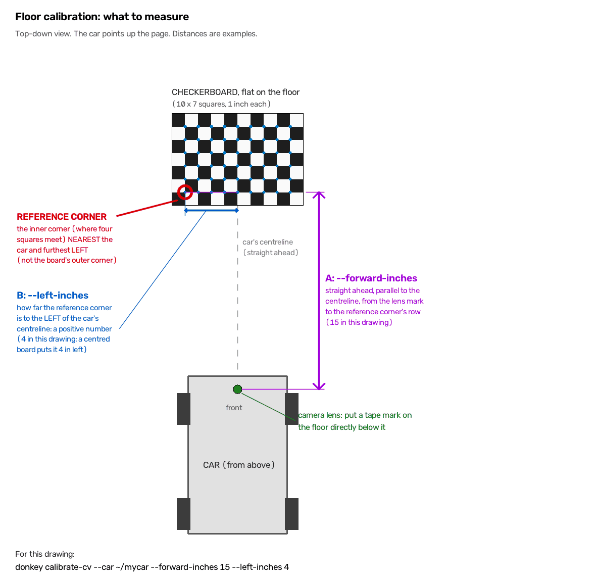

# Driving a donkeycar with an AI agent

A self-contained user manual for sharing by email or chat is in
[`mcp-server-manual.html`](mcp-server-manual.html): one file, no external resources.

An MCP server that lets an LLM agent read the car's state and set its intent while
the computer-vision autopilot follows a taped line. The autopilot steers at 20 Hz;
the agent decides how fast to go and which lane to hold.

The agent is never in the steering path. That is deliberate: an agent round trip
takes a second or more, and at that cadence a car following a line would be a
segment behind the road.

---

## 1. Build a track

The track is a **centreline of tape** &mdash; 1 inch yellow by default &mdash; with optional
**side-lines** marking its edges:

```
   │         ┊         │
   │         ┊         │      <- side-lines (optional), e.g. white
   │         ┊         │
   │         ┊         │      <- centreline, solid or dashed, e.g. yellow
   │         ┊         │
```

Rules of thumb:

- Avoid crossings, and keep turns gentle &mdash; the follower loses the line on tight ones.
- The centreline may be dashed. Dashes score lower confidence than solid tape; see
  **CONFIDENCE_THRESHOLD** below before tuning around it.
- Use a side-line colour well away from the centreline's, so the follower's colour
  window cannot match it.
- The width and the centreline's position are allowed to vary along the course. Nothing
  assumes they are constant.
- Start with a straight line that dead-ends, then close it into a loop.

### Traffic features

Print [`assets/track-cards/track-cards.pdf`](../assets/track-cards/track-cards.pdf) —
7 sheets giving 13 fold-over tents, each showing the same image on both faces so the
car reads it the same whichever way it approaches:

- **Signs** — stop sign, and a traffic light in red, yellow and green
- **Obstacles to wait out** — child chasing a ball, adult with a stroller, elderly
  man with a cane, dog
- **Obstacles to drive around** — car, truck
- **Addresses** — houses numbered 123, 456 and 789

Print at 100%, on matte stock — **not glossy**. These exist to be read by a camera,
and under overhead lights a glossy stop sign throws a specular highlight that blows
out exactly the region a vision model needs. Assembly, paper weights and printer
settings are in [`assets/track-cards/README.md`](../assets/track-cards/README.md).

Put a feature beside a straight stretch to begin with, so the car has room to see it and
stop.

**Features are not configured anywhere.** The agent finds them in the camera image.
That is the point of the exercise, and it means you can move a sign or drop an
obstacle in the road without editing a file.

## 2. Describe the track

`donkey createcar` puts a `track.yml` in the car directory. Edit it to match what
you built. This file is the only place the track is described; nothing in
`config.py` or `myconfig.py` describes it.

```yaml
name: Kitchen loop                 # optional: describe the track itself
description: Yellow centreline, white side tape, one gentle S-bend.

cv_control:                        # required: what the CV autopilot needs to know
  continuous: false                # required: true for a loop, false for a dead-end
  lanes:                           # required: offsets from the centreline, inches
    left: -9.0                     # must be negative
    right: 9.0                     # must be positive

  lap_length_inches: 480.0         # optional: measured along the centreline

  centerline:                      # optional
    tape_color: yellow             # a label only; see below
    width_inches: 1.0
    dashed: true

  side_lines:                      # optional; omit either side if it has none
    tape_color: white
    left_inches: 18.0              # distance from the centreline
    right_inches: 18.0
```

**Everything but `name` and `description` lives under `cv_control:`**, the section for the
computer-vision template. When another template is added to the MCP server it gets its own
section, so the two cannot collide. The agent learns which section to read from the
`get_autopilot` tool.

**Every distance here is nominal.** Measure it once at a representative spot. The real
width and the centreline's position vary along the course, and `cv_control-get_track_config` tells
the agent so: where it matters, the agent measures the side-lines in the camera frame
with `measure_ground_point` instead of trusting these numbers.

**A `tape_color` is only a label.** The colour the follower actually matches is the HSV
window `COLOR_THRESHOLD_LOW` / `COLOR_THRESHOLD_HIGH` in `myconfig.py`, which the agent can
read with `cv_control-get_autopilot_config`.

`lanes` must name `left` and `right`. The `center` lane is always the centreline, and
configuring it &mdash; even as 0 &mdash; is refused, so `cv_control-set_control(lane="left")`,
`"center"` and `"right"` work on every track: the left lane, on the centreline, and the
right lane. Further named lanes are allowed.

Validation is strict and unknown fields are rejected, so a typo fails loudly rather
than reading as "never set". A silently wrong lane width is a car in the wall, and a
lane with the wrong sign is refused for the same reason.

**More than one track.** Keep a file per track beside `track.yml` &mdash; say
`track-garage.yml` and `track-office.yml` &mdash; and choose one when the car starts:

```
python manage.py drive --mcp --track=track-office.yml
donkey mcp --car ~/mycar --track track-office.yml
```

A relative path is taken from the car directory; an absolute path is used as given.
A `--track` file that is not there stops the server from starting, naming the path it
looked for, rather than quietly driving some other track.

**No track file at all.** The server still starts, gives the agent a default track
with generic `left`, `center` and `right` lanes, and logs a warning naming the
`track.yml` it looked for.

**Upgrading an older `track.yml`.** A file in an earlier shape is refused, naming what to
change:

- **Fields at the top level** other than `name` and `description` (`continuous`, `lanes`,
  `lap_length_inches`, `centerline`, `side_lines`): move them under `cv_control:`.
- **`color` in `centerline` or `side_lines`**: rename it `tape_color`.
- **Segment fields** (`segment_length_inches`, `cross_length_inches`, `segment_count`,
  `cross_colors`, `tape_width_inches`, `tape_color` at the top level): delete them, putting
  the tape's colour and width under `cv_control: centerline:` if you want to keep them.
- **`center` in `lanes`**: delete it.

The `TRACK_SEGMENT_*` constants in an old `config.py` are simply ignored. So are
`TRACK_CONTINUOUS`, `TRACK_LAP_LENGTH_INCHES` and `TRACK_LANES_INCHES` in an old
`config.py` or `myconfig.py`, which once described the track when there was no
`track.yml`: move their values into `track.yml` and delete them.

A lane offset says where **the car** should sit: positive is right of the centreline,
the way a person would describe it. The controller works in the opposite frame &mdash;
it steers the *tape* to a column in the image, and putting the car right of the line is
the same as putting the line left of centre &mdash; but converting between the two is
the server's job, not yours. Fill this file in as a person sees the track.

## 3. Calibrate the camera

A lane offset given in inches has to become a pixel offset, so the car needs to know
how many pixels an inch is worth on the ground.

Print the board first: [`assets/checkerboard/calibration-checkerboard-9x6-1in-letter.pdf`](../assets/checkerboard/calibration-checkerboard-9x6-1in-letter.pdf)
(or the A4 version). **Print at 100% / actual size** — "Fit to Page" silently shrinks
it, and a board printed at 96% gives a confident, wrong calibration rather than an
error. Check with a ruler that 10 squares measure 10 inches, then mount it on
something rigid: a curled sheet is a curved plane, and the maths assumes a flat one.

```
donkey calibrate-cv --car ~/mycar
```

Then open `http://localhost:8892`:

1. Lay the board **flat on the floor** in front of the car. Held upright it gives
   meaningless numbers.
2. Slide it until the blue band crosses the board and the corners turn green. The
   blue band is the strip the follower actually samples.
3. Press **Capture**. It writes `cv_calibration.json` beside your config.

**Every capture is kept**, refused or not, in its own folder,
`cv_calibration_captures/<date-time>/` in the car directory: `frame.png` as the camera saw it,
`preview.png` with the scan band, corners and reference corner drawn on, and `capture.json`
with what you entered (`--forward-inches`, `--left-inches`, board and square size), the scan
row, every corner found, the outcome, and the calibration exactly as written. A refused
capture's frame is what shows why it was refused. Nothing deletes old folders.

The same corners also solve a ground homography, which is what lets the agent ask
"how far ahead is that?". Without it the only cue is apparent size, guessed over a
network round trip while the car keeps moving.

To get answers in car coordinates rather than the board's own frame, say where the
board was. Measurements are taken to the board's **reference corner**: of the points where
four squares meet, the one nearest the car and furthest left, as the camera sees it. The
preview rings it and labels it "measure to here". It is one square in from the board's
near-left edge, not the board's outer corner.



[`floor-calibration-measurements.png`](floor-calibration-measurements.png), drawn by
[`floor_calibration_diagram.py`](floor_calibration_diagram.py), shows both measurements from
above.

1. Put a tape mark on the floor directly below the camera lens.
2. `--forward-inches` is the floor distance **straight ahead**, parallel to the car's
   centreline, from that mark to the reference corner's row. Do not measure diagonally.
3. `--left-inches` is how far the reference corner is **to the left** of the car's
   centreline. A 9&times;6-corner board centred in front of the car puts it at about 4. Give a
   negative number only if the corner is to the right of the centreline.

```
donkey calibrate-cv --car ~/mycar --forward-inches 15 --left-inches 4
```

Everything the tools report counts lateral as positive to the *right*; the flag is the other
way round only because the corner is nearly always on the left, and is converted on the way
in.

### Where to put the board

Two things decide whether the numbers are worth having.

**Big enough to find.** At donkeycar's stock 320&times;240 a 10&times;7 inch board lying
where the scan line falls is about 8 pixels per square, which is below what the corner
detector resolves &mdash; it reports no board at all on a frame where the board is
plainly visible, flat, sharp and well lit. The detector retries on an upscaled copy for
exactly this case and usually succeeds anyway. If the preview still says NO BOARD, the
answer is almost always to move the board closer, not to change the lighting.

**As close to the scan row as you can manage.** `pixels_per_inch` is evaluated at
`SCAN_Y`, and a homography fitted from corners that all sit well below that row is
extrapolating to reach it. On one car the board covered image rows 128&ndash;142 while
`SCAN_Y` was 100, roughly 37 inches further out; perturbing the corners by a third of a
pixel moved the answer by 5% at the scan row, against 0.4% at rows the board actually
covered. Straddle the scan line if the board can still be found there. If it cannot, 5%
is usually tolerable &mdash; a 6 inch lane offset still lands within a pixel &mdash; but
that is the weakest number in the calibration and worth knowing about.

**Without the offsets, zero is the reference corner, not the car.** Leave
`--forward-inches` and `--left-inches` at 0 and `measure_ground_point` measures from the
reference corner, so the middle of the frame will not read zero laterally, and forward
distances are short by however far ahead the board was. Scale is unaffected, so lane
offsets are right either way; only absolute positions shift. Calibrations captured before
the reference corner was defined measured from whichever corner the detector reported
first, which could be any of the four; recapture to get a known origin.

**No printer?** Lay two strips of the follow-tape a known distance apart:

```
donkey calibrate-cv --car ~/mycar --tape-separation-inches 10
```

That gives the scale but no homography, so lane changes work and distance
measurement does not.

### Calibrating the camera itself (optional)

Everything above calibrates the **floor**: how pixels map to the ground in front of the
car. That is all lane changes and `measure_ground_point` need. Measuring an object by its
known size &mdash; "this stop sign is 6 inches tall and 40 pixels high, so it is about 35
inches away" &mdash; also needs the camera's focal length and lens distortion, which the
floor calibration cannot supply: on one car, the two ways of recovering a focal length from
the floor homography disagreed by 40%. So there is a second, optional calibration. Without
it, `measure_object_distance` and `estimate_speed_from_object` answer `known: false`.

```
donkey calibrate-cv --car ~/mycar --intrinsics
```

Open `http://localhost:8892`. This time **hold the board up** in front of the camera,
the opposite of the floor capture:

1. Hold it still until the corners turn green, then press **Add view**.
2. Move or tilt it and add another. Tilt it left, right, up and down, near and far, and
   put it in every part of the frame, **corners included**: the lens bends most at the
   corners, and the grid on the page shows which quadrants have no views yet.
3. After at least 12 views (15&ndash;20 is better), press **Solve**. It writes
   `camera_intrinsics.json` beside your config and shows the focal length and RMS error.

A good capture at 320&times;240 lands well under 0.5 px RMS. Solve refuses, saying what to
fix, with fewer than 12 views, an empty quadrant, or more than 1 px RMS &mdash; usually a
blurred or moving board.

**Every view is kept.** Each capture writes its frames to
`camera_calibration_views/<date-time>/view_NN.png` in the car directory, with a `views.json`
recording each view's error and the outcome, refused or not. Nothing deletes old folders. To
solve again from a saved folder, on the car or a laptop, with no camera:

```
donkey calibrate-cv --car ~/mycar --from-images ~/mycar/camera_calibration_views/2026-10-22T14-05-00
```

**When to redo it.** This calibration describes the camera, lens and resolution, not how the
camera is mounted, so re-mounting needs only the floor calibration. Redo it after changing
`IMAGE_W`, `IMAGE_H` or `CAMERA_TYPE` (`cv_control-get_calibration` then reports the camera
section `stale`), or after swapping the camera or lens, which it cannot detect.

### Tuning the line colour

The follower finds the tape by thresholding hue, saturation and value, and the
default window is wide: hue 0&ndash;50 from saturation 50 up. That admits skin,
denim, ceiling lights and pale flooring, so a person walking past can capture the
histogram peak and swing the steering to full lock.

Save a few frames from your own car in your own lighting, then:

```
donkey calibrate-color --images "~/frames/*.jpg" --compare
```

It measures the tape's actual colour, proposes a window around it, and &mdash; the
part that matters &mdash; checks that window against every frame you gave it:

```
  frame-102058.jpg   peak col 150  coverage  1.7%  concentration 100.0%
  frame-102304.jpg   peak col 150  coverage  1.4%  concentration 100.0%
```

**Concentration is the number to watch**, not coverage. A wide window matches
more of the band but spreads it, and the histogram peak then lands wherever the
lighting is brightest. A tight window matches less and clusters it on the tape.

Point `--region X,Y,W,H` at the tape if the automatic search picks the wrong
thing, or `--pick` to drag a box.

Capture the frames with `OVERLAY_IMAGE = False`. With it on, the scan band in the
saved image is the follower's own mask rather than the scene, and calibrating
from that measures the previous answer. The command detects and excludes such
rows, and says so, but a clean frame is better.

### CONFIDENCE_THRESHOLD changed meaning

It is now the **fraction of the scan column** that must match the tape colour,
0.0 to 1.0, defaulting to 0.15.

It was previously compared against a raw sum of mask values &mdash; 255 per matching
pixel &mdash; while being documented as a fraction with a default of 0.0015. One
matching pixel scored 255 and cleared it, so **the gate could never reject
anything**. On a real track a ten-pixel speck at the edge of the frame counted as
a confident line detection: the follower chased it, steering saturated, and the
car drove off the course.

Measured on that track: tape genuinely in view scores 0.28&ndash;0.44, and the speck
that caused the crash scored 0.125.

**Dashed tape can never fill the band.** Confidence is lit rows over `SCAN_HEIGHT`, so
a track laid in dashes only ever scores what a single dash covers. On one course with
`SCAN_HEIGHT = 80` a dash lit 10&ndash;25 rows, putting confidence between 0.12 and 0.31
&mdash; straddling the 0.15 default, which reads as the line flickering in and out while
the car is in fact tracking it perfectly well. Either lower the gate or shorten
`SCAN_HEIGHT` so a dash covers more of it, but check real frames before deciding: the
same change also raises what a reflection scores, and that is what the gate is for.

If your config still has a value near 0.0015, the gate stays effectively open and
you keep the behaviour you had &mdash; nothing breaks on upgrade. Raise it to around
0.15 to actually get the protection.

**A calibration file always wins.** `CV_PIXELS_PER_INCH` in `myconfig.py` is used only
when the car directory has no `cv_calibration.json`. Without a capture, a standard 1/16
scale Donkeycar (PiCamera at 320x240, `SCAN_Y = 100`) measures about 3.43, a good
starting value for a car built to the standard design.

**Recalibrate whenever the camera moves.** The calibration records the `SCAN_Y`,
image size and camera type it was taken with, and `cv_control-get_calibration` reports when
those no longer match — but it cannot tell that someone knocked the camera.

## 4. Run the server

First install the `mcp` extra. It is optional, so no platform extra pulls it in
and a normal car install will not have it:

```zsh
uv pip install -e ".[pi,dev,mcp]"     # on the car, from a clone
uv pip install "donkeycar[pi,mcp]"    # on the car, from PyPI
```

Swap `pi` for `pc` or `macos` off the car. Without it both commands below stop
and tell you to install it.

Two ways to run, depending on who should own the process.

**Alongside a normally launched car.** The car runs as usual and serves MCP from
inside the drive loop:

```
python manage.py drive --mcp
```

`start` and `stop` arm and disarm the car here; they cannot restart the loop,
because returning from the drive loop ends the program.

**Server owns the vehicle.** Real lifecycle control — `stop` tears the loop down and
`start` builds a new one:

```
donkey mcp --car ~/mycar
```

Either way, add `--track <file>` to use a track file other than `track.yml`; see
**2. Describe the track**. The tools are at `http://<host>:8891/mcp`. Nothing is running until the
agent calls `start`, and the car does not move until it also sets a throttle.
Before making the server reachable from another machine, set `MCP_SERVER_TOKEN`;
see **6. Security**.

### Upgrading a car that already exists

Pulling new code onto the Pi is only the first step. A car directory holds
*copies* of `manage.py` and `config.py` taken when it was created, and the
supervisor prefers the car's own `manage.py` so that local changes survive. A
template change therefore does not reach an existing car on its own, and the
failure is silent &mdash; the car keeps running, just without the new behaviour.

**1. Pull the code.**

```zsh
cd ~/projects/donkeycar && git pull
```

**2. Refresh the car's copies.** Run it *from inside the car directory*, and
name the template &mdash; without `--template` it defaults to `complete` and you
will get the wrong car app:

```zsh
cd ~/mycar
donkey update --template cv_control
```

That rewrites `manage.py` and `config.py` from the template and leaves
`myconfig.py` alone. Back up `manage.py` first if you have edited it.

**3. Check `myconfig.py` for overrides of anything that changed.** `myconfig.py`
wins over `config.py`, so a stale value there survives step 2. The one that
bites is `CV_CONTROLLER_OUTPUTS`: a car created earlier has

```python
CV_CONTROLLER_OUTPUTS = ['pilot/steering', 'pilot/throttle', 'cv/image_array']
```

`Memory.put` assigns by position, so extra values the controller returns are
simply dropped. That is deliberate &mdash; it is what keeps old configs working &mdash;
but it means new outputs never arrive, and everything downstream reads `None`
with no error anywhere. The current list is:

```python
CV_CONTROLLER_OUTPUTS = ['pilot/steering', 'pilot/throttle', 'cv/image_array',
                         'cv/confidence', 'cv/line_detected']
```

**4. Restart the server, not just the vehicle.**

```zsh
pkill -f "donkey mcp"
donkey mcp --car ~/mycar --host <the car's LAN address>
```

`start` re-reads the *config*, but the builder module is imported once when the
process starts, so a changed `manage.py` needs a real restart. As a rule: config
values reload, code does not.

### Reading a run that went wrong

Several failure modes look like something else entirely:

| What you see | What it usually is |
| --- | --- |
| `line_detected` true on ~100% of samples, steering barely varying | **The car is not moving.** An unpowered ESC produces a flawless-looking trace, because a stationary camera sees the same tape in every frame. Genuine driving on this course held the line about 86% of the time. Vary-free perfection is the tell. |
| No line for the first several seconds after `start`, then it appears | The camera's auto-exposure is still settling. Measured on one car, confidence climbed from 0.07 to 0.36 over a few seconds while nothing moved. Wait for the line rather than judging placement from the first frames. |
| The car drives for two seconds and stops | The command watchdog. See **Commands expire**. |
| Steering pinned at full lock | Check `line_detected` first. The follower decays steering toward centre while blind, so a hard steering value means something completely different depending on whether the line is in view. |
| The tape looks badly off-centre at the scan row | Not necessarily a placement problem. `SCAN_Y` looks tens of inches ahead &mdash; about 37 on one car &mdash; so the tape's column there mixes lateral offset with the car's heading and with the track's curvature over that distance. On a bend a correctly placed car reads as badly offset. |

### Tuning without restarting

`start` re-reads the car's config, so the loop is:

1. edit `myconfig.py` (thresholds, `SCAN_Y`, `SCAN_HEIGHT`, lane offsets)
2. call `stop`, then `start`
3. look at the next `cv_control-get_vehicle_state` frame

A config that will not parse fails the `start` and leaves the previous one in
place, so a typo does not take the server down with it. `MCP_SERVER_HOST` and
`MCP_SERVER_PORT` are the exception: the socket is already bound, so changing
those needs a real restart, and the server logs a warning saying so. Pass
`--no-reload` to keep the config fixed for the life of the process.

## 5. The tools

Tools that only make sense for the computer-vision autopilot start with `cv_control-`, the
name `get_autopilot` returns, and a dash. A future autopilot adds its own prefixed tools without
colliding. No tool name otherwise contains a dash, so a name without one &mdash; `get_autopilot`,
`start`, `stop`, `emergency_stop`, `measure_ground_point`, `measure_object_distance`,
`estimate_speed_from_object` &mdash; applies to any autopilot.

| Tool | What it does |
| --- | --- |
| `get_autopilot` | The name of the autopilot driving the car, `cv_control`, and its `tool_prefix`, `cv_control-`. The name is also the section of `cv_control-get_track_config` to read. Call first. |
| `cv_control-get_autopilot_config` | The settings the autopilot is running with, from `config.py` and `myconfig.py`: HSV colour window, confidence gate, scan row and height, steering and PID, throttle range, loop rate. Read-only; unset settings are `null`. Reloaded on every `start`. |
| `cv_control-get_track_config` | The track's name and description, and its `cv_control` section: loop or dead-end, lap length, centreline and side-lines, and the named lanes (always `left`, `center`, `right`). Distances are nominal and tape colours are labels; `nominal` and `note` say so. Call once. |
| `cv_control-get_vehicle_state` | Camera frame plus throttle, steering, lane, mode. `live` says whether the vehicle loop is still writing; when it is false the car-derived fields are null and there is no frame, so a stopped car cannot look like a running one. `loop_count` rises every loop. |
| `cv_control-set_control` | Set throttle and/or lane. Give `lane` by name, or `lane_offset_inches` for finer control. |
| `measure_ground_point` | Turn a pixel into a position on the ground, in inches. This is how you know when to brake. |
| `measure_object_distance` | The range to an object of known size from its bounding box: `box` (`x_min`, `y_min`, `x_max`, `y_max` in pixels) and `width_inches` and/or `height_inches`. Returns `range_inches` with `range_uncertainty_inches`, each size's own estimate and their `size_disagreement`, and with a floor calibration `forward_inches` / `lateral_inches`. Needs the camera calibration, else `known: false`. |
| `estimate_speed_from_object` | The car's closing speed on a stationary object of known size, from two or more `observations`, each `{timestamp, box}` with the `timestamp` `cv_control-get_vehicle_state` returned. Returns `closing_speed_inches_per_s` (positive is closer) with its uncertainty and a `warning` when the frames are under 0.5 s apart or the answer is too rough to use. Needs the camera calibration, else `known: false`. |
| `start` / `stop` | Begin and end driving. `start` re-reads `config.py` and `myconfig.py` first, so tuning is edit &rarr; stop &rarr; start &rarr; look, with no server restart. |
| `emergency_stop` | Zero the throttle now, without touching the lifecycle. |
| `cv_control-get_calibration` | Scale, homography, whether either has gone stale, and `loaded_from`: the calibration file's path, or `CV_PIXELS_PER_INCH` when there is no file. A `camera` section carries the optional camera calibration, or `calibrated: false`. |

`cv_control-get_vehicle_state` also reports `line_detected` and `line_confidence`. Watch
them: a hard steering value means something entirely different depending on
whether the autopilot can see the line. Following a bend and driving blind at the
lock it last held look identical otherwise &mdash; on a real track that difference
put a car off the course. When the line is lost the payload carries a `warning`
and the follower decays steering back toward centre, but it keeps moving until
you set the throttle to 0.

### Measuring an object of known size

`measure_object_distance` assumes the object is upright and turned roughly toward the
camera, and that the box is tight. Give both sizes when you know them: a large
`size_disagreement` means the box is loose or the size is wrong. On synthetic tests with a
camera pitched 10&deg; down it is within 3% at 5 and 10 feet and 5% at 2 feet, before any
error in the box itself. `range_uncertainty_inches` assumes each box edge is within 1 pixel;
a box drawn by a language model is often rougher, so widen it accordingly.

For speed, more frames further apart beat two close together. Frames 0.1 s apart move the car
about as far as the box wobbles, and box noise then inflates the speed and its uncertainty
together &mdash; which is why anything under half a second carries a `warning` whatever the
numbers say.

### Throttle is a ceiling, not a command

`cv_control-set_control(throttle=0.8)` does **not** drive at 0.8. The autopilot computes its own
throttle and slows itself in corners; your value caps it. So:

- A high value does not make the car corner faster.
- A low value does slow it down.
- `0` always stops it.

This keeps the autopilot's cornering behaviour intact while leaving you able to slow
and stop. There is no way to override it from the tool surface, on purpose.

### Commands expire

If no command arrives for `MCP_COMMAND_TIMEOUT_S` (2 seconds by default) the throttle
goes to zero. Agent silence — a crash, a dropped connection, a long think — stops the
car rather than letting it continue blind. **Keep calling `cv_control-set_control` while you want
the car to move.**

Reading state does **not** reset the timer &mdash; only a command does. So the obvious
driving loop, command once and then poll `cv_control-get_vehicle_state` to watch what happens,
gives you a car that moves for two seconds and parks, while the state you are reading
goes on reporting the throttle you asked for. `watchdog_tripped` in the state payload
says when this has happened, and sending the same values again is the normal way to
hold a speed.

## 6. Security

The server can make a vehicle move, so treat the port as a control surface. Two
things guard it.

**A token.** Set one in `myconfig.py` before the server is reachable from the
network:

```python
MCP_SERVER_TOKEN = "a-long-random-string"   # e.g. from: python -c "import secrets; print(secrets.token_urlsafe(32))"
```

Every request must then carry `Authorization: Bearer <token>`; anything else gets
`401`. Without a token, anyone who can reach the port can drive the car, and the
server says so in a warning at startup when it is bound beyond `127.0.0.1`. Keep the
token in `myconfig.py` only &mdash; there is deliberately no command-line flag, which
would put it in `ps` output and shell history. Changing it needs a restart.

Clients send it as a header:

```zsh
claude mcp add --transport http donkeycar http://<car>:8891/mcp \
  --header "Authorization: Bearer <token>"
```

```json
{
  "mcpServers": {
    "donkeycar": {
      "type": "http",
      "url": "http://<car>:8891/mcp",
      "headers": { "Authorization": "Bearer <token>" }
    }
  }
}
```

**A host check.** Every request's `Host` header must be a name this car answers
to: `localhost`, `127.0.0.1`, the machine's hostname with and without `.local`, and
the bind address &mdash; or, bound to `0.0.0.0`, every address the machine reports
for itself. This is DNS-rebinding protection: it stops a web page in someone's
browser from pointing its own domain at the car and calling the tools. A client
that reaches the car by another name gets `421` with that name and the fix, which
is to add it to `MCP_SERVER_ALLOWED_HOSTS`:

```python
MCP_SERVER_ALLOWED_HOSTS = ["racecar.example"]
```

**What it does not do.** The server speaks plain HTTP, so the token crosses the
network unencrypted. It keeps out a guest on the WiFi, not someone capturing its
traffic. Prefer binding to the car's LAN address over `0.0.0.0`, and keep the car on
a network you trust.

## 7. A worked example

These are the settings one car ended up with after a session of tuning on a real
indoor track. **The numbers are that car's, not yours** &mdash; they depend on its
ESC, its servo, its camera mount and the lighting in that room. What transfers is
the *method*: every value below was measured rather than guessed, and the
measurement is given so you can repeat it.

```python
# colour, from `donkey calibrate-color` on five clean frames
COLOR_THRESHOLD_LOW  = (17, 103, 104)
COLOR_THRESHOLD_HIGH = (37, 255, 255)
CONFIDENCE_THRESHOLD = 0.15

# where and how much to look
SCAN_Y      = 100
SCAN_HEIGHT = 80

# pin the reference column; see below
TARGET_PIXEL = 160

# when to treat it as a corner
TARGET_THRESHOLD = 20

# speed
THROTTLE_MIN = 0.25
THROTTLE_MAX = 0.3

PWM_STEERING_THROTTLE = {
    "STEERING_RIGHT_PWM":   300,
    "STEERING_LEFT_PWM":    440,
    "THROTTLE_STOPPED_PWM": 370,
    "THROTTLE_FORWARD_PWM": 450,
    ...
}
```

### How each one was arrived at

**Colour and confidence.** `donkey calibrate-color` measured the tape at hue
24&ndash;31, saturation 123+, value 135+, and proposed a window with margin. Tape
genuinely in view scored 0.28&ndash;0.44 on the confidence scale; a ten-pixel speck at
the frame edge that had sent the car off course scored 0.125. 0.15 sits between.

**`THROTTLE_FORWARD_PWM`.** The car would not move at all. Converting to
microseconds showed why: at the original 400, full throttle was only +122&nbsp;&micro;s
above neutral, and 0.3 throttle just +37&nbsp;&micro;s &mdash; inside the ESC's deadband.
Ramping the commanded throttle found the car first moved at about **+72&nbsp;&micro;s**.
450 puts 0.3 throttle at +98&nbsp;&micro;s, comfortably past it.

**`THROTTLE_MIN`.** At 0.15 the ESC sees +49&nbsp;&micro;s &mdash; enough to keep rolling,
since rolling friction is lower than stiction, but not to start again. The car
slowed for a corner, stopped, and could not restart. 0.25 gives +81&nbsp;&micro;s, just
above the measured threshold.

**Steering PWM.** The original 345&ndash;415 is &plusmn;142&nbsp;&micro;s, about a third of a
typical RC servo's travel. The symptom was the PID winding to full lock and the
car never recovering. 300&ndash;440 is &plusmn;285&nbsp;&micro;s, and corners then entered *and
exited* &mdash; steering peaked around 0.5 and came back rather than pinning at 1.0.

**`TARGET_THRESHOLD`.** Steering is `Kp` times the pixel error, so with
`PID_P = -0.01` the pixel error is roughly `steering * 100`. Logging a real run
gave a median error of 19&nbsp;px, which meant the stock threshold of 10 classified
83% of the run as cornering and the car almost never reached `THROTTLE_MAX`.
Raising it to 20 took mean throttle up 41% and time-at-maximum from 4% to 48%.

**`THROTTLE_MAX`.** 0.4 was tried and reverted: on a tight section it produced
four lost-line events against zero at 0.3.

**`SCAN_Y`.** 60, 100 and 140 were all tried. 100 was best. Looking nearer (140)
meant the car could not see where the line was going; looking further (60) made
the tape thinner in frame, so confidence fell and the gate rejected it.

**`TARGET_PIXEL = 160`** &mdash; the image centre, pinned rather than left at `None`.

Left unset, the follower latches its reference from the first frame containing a line,
and a lane offset is then measured from wherever the tape happened to be in that one
frame rather than from the car's centreline. "Six inches right" only means six inches
right if the car started square on the line. Pinning it to the middle of the image makes
the offset mean the same thing on every run.

It also removes a failure mode worth knowing about even if you leave it unset. The
latch used to happen before the confidence gate, so a car started while looking away
from the tape anchored itself to the argmax of an empty scan band &mdash; on this car a
reflection at column 18, scored 0.087 against a threshold of 0.15, became the place it
spent the rest of the run steering toward. The latch now waits for a frame that clears
the gate.

### The general lesson

Three of these were the same bug in different clothes: **a control range too
narrow to do anything with**. Throttle spanned 30 PWM counts, steering 70, and in
both cases the software was working perfectly and commanding values the hardware
could not act on. If a car will not move, or will not turn, convert the PWM
numbers to microseconds before touching anything else.

## 8. Testing without a car

Everything above is exercisable on a laptop.

```
CAMERA_TYPE = 'MOCK'         # or 'IMAGE_LIST' with recorded track footage
DRIVE_TRAIN_TYPE = 'None'
```

`IMAGE_LIST` plus a recorded tub gives deterministic replays against real footage.
